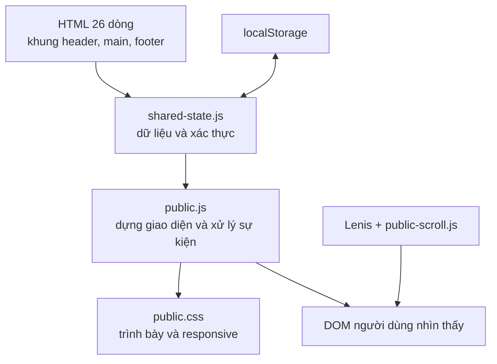
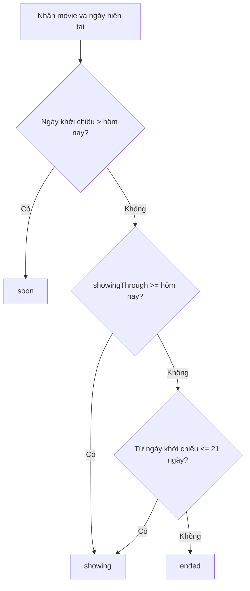
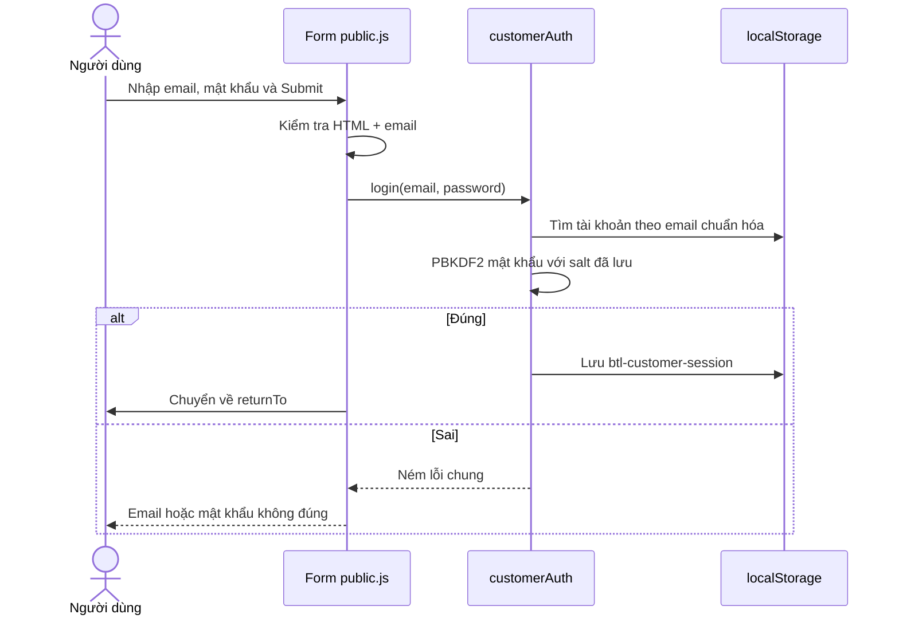
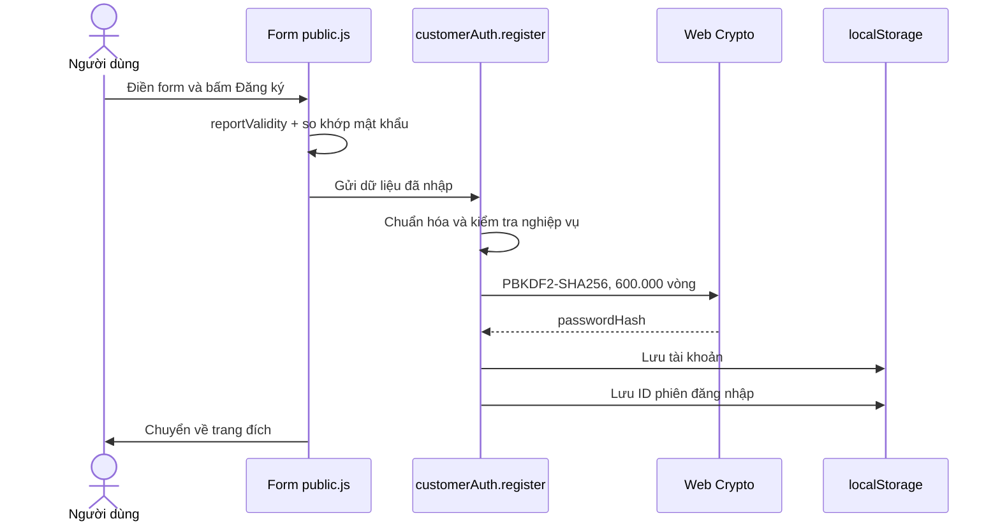

# BẢN THUYẾT TRÌNH: BỐN TRANG KHÁCH HÀNG CỦA UCC

## Phạm vi trình bày

Bản thuyết trình này phân tích bốn trang:

1. Trang chủ: `index.html`
2. Trang lịch chiếu: `movies/index.html`
3. Trang đăng nhập khách hàng: `login/index.html`
4. Trang đăng ký khách hàng: `register/index.html`

Mỗi vị trí code trong tài liệu được ghi theo dạng `tên-file:dòng-bắt-đầu–dòng-kết-thúc`. Số dòng được đối chiếu trực tiếp với phiên bản repository tại commit gốc `3672356` và không phải số dòng ước lượng.

---

## Slide 1 — Giới thiệu đề tài

**Nội dung trên slide**

- Tên hệ thống: UCC — Trung tâm Chiếu phim Giao thông vận tải.
- Công nghệ: HTML5, CSS3 và JavaScript thuần.
- Phạm vi: trang chủ, lịch chiếu, đăng nhập và đăng ký khách hàng.
- Dữ liệu demo được lưu ở trình duyệt, chưa có backend và cơ sở dữ liệu máy chủ.

**Lời thuyết trình gợi ý**

“Đề tài xây dựng giao diện website đặt vé cho Trung tâm Chiếu phim Giao thông vận tải. Bốn trang em trình bày đều dùng chung một kiến trúc: HTML tạo khung trang, JavaScript dựng nội dung theo từng loại trang, CSS định dạng giao diện, còn `shared-state.js` quản lý dữ liệu và xác thực. Ứng dụng hiện là bản demo phía trình duyệt; dữ liệu được lưu bằng `localStorage`.”

**Vị trí code**

- Khung HTML: `index.html:1–26`, `movies/index.html:1–26`, `login/index.html:1–26`, `register/index.html:1–26`.
- Màu sắc, font và định dạng chung: `public.css:1–127`.
- Dữ liệu dùng chung: `shared-state.js:865–938`.

---

## Slide 2 — Kiến trúc tổng thể

**Nội dung trên slide**



**Lời thuyết trình gợi ý**

“Điểm quan trọng nhất là nội dung thực tế không được viết sẵn trong từng file HTML. Bốn file HTML chỉ cung cấp ba vùng `header`, `main`, `footer` và khai báo loại trang bằng thuộc tính `data-page`. `shared-state.js` phải chạy trước để tạo `cinemaState` và `customerAuth`. Sau đó `public.js` đọc `data-page`, chọn đúng hàm dựng trang và gắn các sự kiện tương tác.”

**Vị trí code**

- Ba vùng DOM rỗng: mỗi file HTML, dòng `17–19`.
- Thứ tự tải script: mỗi file HTML, dòng `21–24`.
- Đọc loại trang: `public.js:2–4`.
- Bộ định tuyến phía giao diện: `public.js:402–416`.
- Cuộn mượt: `public-scroll.js:1–28`.

---

## Slide 3 — Khung HTML dùng chung của bốn trang

**Nội dung trên slide**

| Phần | Dòng | Chức năng |
|---|---:|---|
| `<!doctype html>` và `lang="vi"` | 1–2 | Khai báo HTML5 và ngôn ngữ tiếng Việt |
| `meta charset`, `viewport` | 4–5 | Unicode và hiển thị đúng trên điện thoại |
| SEO, màu trình duyệt, tiêu đề | 6–8 | Mô tả trang, theme và tên tab |
| favicon và font | 9–11 | Logo tab và tải trước Montserrat |
| CSS Lenis và CSS chính | 12–13 | Cuộn mượt và toàn bộ giao diện |
| `data-page` | 15 | Cho JavaScript biết phải dựng trang nào |
| skip link | 16 | Hỗ trợ bàn phím đi thẳng tới nội dung |
| `header`, `main`, `footer` | 17–19 | Điểm gắn nội dung động |
| `noscript` | 20 | Thông báo khi JavaScript bị tắt |
| bốn script | 21–24 | Dữ liệu → giao diện → Lenis → cấu hình cuộn |

**Lời thuyết trình gợi ý**

“Bốn file HTML gần như giống nhau. Hai khác biệt có ý nghĩa là tiêu đề ở dòng 8 và `data-page` ở dòng 15. Cách tổ chức này giảm lặp code: menu, footer và các component chỉ được viết một lần trong `public.js`.”

**Vị trí code cụ thể**

- Trang chủ: tiêu đề `index.html:8`, loại trang `index.html:15` là `home`.
- Lịch chiếu: tiêu đề `movies/index.html:8`, loại trang `movies/index.html:15` là `movies`.
- Đăng nhập: tiêu đề `login/index.html:8`, loại trang `login/index.html:15` là `login`.
- Đăng ký: tiêu đề `register/index.html:8`, loại trang `register/index.html:15` là `register`.

---

## Slide 4 — Vì sao phải tải `shared-state.js` trước `public.js`?

**Nội dung trên slide**

- `shared-state.js` tạo hai đối tượng toàn cục:
  - `window.cinemaState`: phim, suất chiếu, phòng, vé và hàm lưu.
  - `window.customerAuth`: đăng ký, đăng nhập, đăng xuất và phiên khách hàng.
- `public.js` sử dụng ngay hai đối tượng này khi bắt đầu chạy.
- Đổi thứ tự script sẽ gây lỗi `cinemaState is not defined`.

**Lời thuyết trình gợi ý**

“Ở dòng 4 của `public.js`, chương trình đọc `cinemaState.site` ngay lập tức. Vì vậy `shared-state.js` bắt buộc đứng trước `public.js` trong HTML. Sau hai file của ứng dụng, thư viện Lenis mới được tải và `public-scroll.js` chỉ cấu hình Lenis khi thư viện tồn tại.”

**Vị trí code**

- Thứ tự script: mỗi file HTML, dòng `21–24`.
- Sử dụng `cinemaState` ngay khi khởi động: `public.js:2–4`.
- Công bố `cinemaState`: `shared-state.js:865–938`.
- Công bố `customerAuth`: `shared-state.js:1088–1168`.
- Kiểm tra thứ tự tải trong test: `tests/public-routes.test.js:5–16`.

---

## Slide 5 — Header, menu và trạng thái tài khoản dùng chung

**Nội dung trên slide**

- Menu được lấy từ dữ liệu `site.navigation`.
- Trang hiện tại được đánh dấu bằng `aria-current="page"`.
- Khi chưa đăng nhập: hiện nút Đăng ký và Đăng nhập.
- Khi đã đăng nhập: hiện “Chào + tên”, nút Đăng xuất và mục “Vé của tôi”.
- Menu mobile có thể mở, đóng và đóng bằng phím Escape.

**Lời thuyết trình gợi ý**

“Header không nằm cố định trong HTML mà được tạo ở `public.js`. Mảng menu chứa bốn đường dẫn Trang chủ, Lịch chiếu, Giá vé và Giới thiệu. Hàm `renderAccount` đọc phiên hiện tại, thay nội dung vùng tài khoản và bổ sung mục Vé của tôi khi có người dùng. Sự kiện `storage` giúp trạng thái cập nhật giữa các tab trình duyệt.”

**Vị trí code**

- Dữ liệu menu: `shared-state.js:20–25`.
- Tạo header và menu: `public.js:38–49`.
- Hiển thị tài khoản: `public.js:51–79`.
- Đồng bộ giữa tab và khi quay lại trang: `public.js:81–94`.
- Menu mobile và phím Escape: `public.js:96–113`.
- CSS header/menu desktop: `public.css:155–259`.
- CSS menu tablet: `public.css:1036–1092`.

---

## Slide 6 — Footer, khả năng tiếp cận và an toàn dữ liệu hiển thị

**Nội dung trên slide**

- Footer có liên kết chính sách, lịch chiếu, giá vé, hỏi đáp và liên hệ.
- `escape()` mã hóa ký tự HTML trước khi chèn dữ liệu vào template.
- Có skip link, nhãn ARIA, vùng `aria-live`, focus rõ ràng.
- `poster()` chỉ chấp nhận ảnh data hợp lệ hoặc URL HTTP/HTTPS.

**Lời thuyết trình gợi ý**

“Dữ liệu phim có thể do quản trị viên chỉnh sửa, vì vậy không nên chèn thẳng vào HTML. Hàm `escape` thay các ký tự đặc biệt bằng HTML entity, giúp giảm nguy cơ chèn mã. Hàm `poster` cũng kiểm tra giao thức ảnh. Về khả năng tiếp cận, trang có skip link, focus outline, `aria-current`, `aria-live` và nhãn cho các nút.”

**Vị trí code**

- `escape`, định dạng ngày và tiền: `public.js:6–20`.
- Kiểm tra URL poster: `public.js:22–32`.
- Footer: `public.js:115–128`.
- Skip link trong HTML: dòng `16` của cả bốn file.
- CSS focus và skip link: `public.css:103–110`, `public.css:129–153`.

---

# PHẦN I — TRANG CHỦ `index.html`

## Slide 7 — Trang chủ được kích hoạt như thế nào?

**Nội dung trên slide**

```text
index.html:15  data-page="home"
        ↓
public.js:3    đọc dataset.page
        ↓
public.js:403–404 gọi home()
        ↓
public.js:140–184 dựng toàn bộ nội dung trang chủ
```

**Lời thuyết trình gợi ý**

“File `index.html` không chứa sẵn banner hay thẻ phim. Dòng 15 đặt `data-page="home"`. Cuối `public.js`, bộ điều phối nhận giá trị này và gọi hàm `home`. Hàm `home` mới tạo nội dung rồi gán vào `main.innerHTML`.”

**Vị trí code**

- Khai báo trang chủ: `index.html:15`.
- Đọc loại trang: `public.js:2–4`.
- Gọi `home()`: `public.js:402–404`.
- Hàm `home()`: `public.js:139–184`.

---

## Slide 8 — Nguồn dữ liệu của trang chủ

**Nội dung trên slide**

- Danh sách phim: `cinemaState.movies`.
- Trạng thái phim: `cinemaState.movieStatus(movie)`.
- Banner: `cinemaState.site.banners`.
- Phim được sắp xếp theo ngày khởi chiếu giảm dần.
- Banner chỉ xuất hiện nếu phim tương ứng còn trong danh mục.

**Lời thuyết trình gợi ý**

“Dòng 141 sao chép mảng phim rồi sắp xếp phim mới trước. Dòng 142 và 143 tách phim đang chiếu và sắp chiếu bằng hàm `movieStatus`. Dòng 144 lọc banner theo `movieId`, nên nếu quản trị viên xóa phim thì banner của phim đó tự biến mất, tránh liên kết tới dữ liệu không tồn tại.”

**Vị trí code**

- Dữ liệu banner: `shared-state.js:27–39`.
- Dữ liệu phim mặc định bắt đầu tại `shared-state.js:322`.
- Getter phim: `shared-state.js:898–900`.
- Thuật toán xác định trạng thái phim: `shared-state.js:730–741`.
- Chuẩn bị dữ liệu trang chủ: `public.js:140–145`.

---

## Slide 9 — Thuật toán xác định phim đang chiếu và sắp chiếu

**Nội dung trên slide**



**Lời thuyết trình gợi ý**

“Trạng thái không tin hoàn toàn vào trường `status` lưu sẵn. Nếu ngày khởi chiếu còn ở tương lai, phim là `soon`. Nếu có mốc xác nhận `showingThrough` và mốc đó chưa qua, phim là `showing`. Nếu không, hệ thống dùng quy tắc mặc định phim chiếu trong 21 ngày từ ngày khởi chiếu.”

**Vị trí code**

- Tạo chuỗi ngày hiện tại: `shared-state.js:714–718`.
- Toàn bộ thuật toán: `shared-state.js:730–741`.
- Trang chủ sử dụng thuật toán: `public.js:141–143`.

---

## Slide 10 — Dựng banner và các khối phim

**Nội dung trên slide**

- `h1` ẩn cho trình đọc màn hình.
- Banner gồm ảnh, nút trước/sau, các chấm chọn và thông báo `aria-live`.
- “Phim đang chiếu” lấy tối đa 8 phim.
- “Phim sắp chiếu” lấy tối đa 4 phim.
- Khi không có dữ liệu, hiển thị empty state thay vì để trống.

**Lời thuyết trình gợi ý**

“Dòng 146 đến 158 tạo một template lớn. Mỗi banner dẫn tới trang chi tiết phim. Banner đầu được ưu tiên tải bằng `fetchpriority="high"`, các banner sau dùng lazy loading. Hai khối phim dùng component `movieCard`, giúp giao diện và cách thoát dữ liệu thống nhất.”

**Vị trí code**

- Component trạng thái rỗng: `public.js:34–36`.
- Component thẻ phim: `public.js:130–133`.
- Component tiêu đề khối: `public.js:135–137`.
- Template trang chủ: `public.js:146–158`.
- CSS banner: `public.css:266–348`.
- CSS lưới và thẻ phim: `public.css:350–500`.

---

## Slide 11 — Điều khiển carousel banner

**Nội dung trên slide**

- Nếu không có banner, hàm kết thúc sớm.
- `current` lưu chỉ số banner hiện tại.
- Công thức modulo cho phép quay vòng đầu/cuối.
- Thuộc tính `hidden` bảo đảm chỉ một banner hiện.
- `aria-pressed` đánh dấu chấm đang chọn.

**Lời thuyết trình gợi ý**

“Hàm `show(index)` chuẩn hóa chỉ số bằng phép modulo. Nếu bấm lùi tại banner đầu thì chỉ số tự chuyển tới banner cuối; nếu bấm tiếp tại banner cuối thì quay lại đầu. Vòng lặp cập nhật `hidden` cho slide, trạng thái `aria-pressed` cho chấm và tên banner trong vùng thông báo dành cho công nghệ hỗ trợ.”

**Vị trí code**

- Kết thúc sớm khi không có banner: `public.js:160–161`.
- Biến trạng thái và danh sách phần tử: `public.js:163–165`.
- Hàm chuyển banner: `public.js:167–176`.
- Nút trước/sau và nút chấm: `public.js:178–183`.
- CSS trạng thái ẩn: `public.css:120–122`.

---

## Slide 12 — Responsive của trang chủ

**Nội dung trên slide**

| Kích thước | Cách hiển thị |
|---|---|
| Trên 1600 px | Banner tối đa 1600 px, cao 680 px |
| 1024–1280 px | Lưới phim 3 cột |
| 641–1023 px | Menu thu gọn, lưới phim 4 cột nhỏ |
| Tối đa 640 px | Banner 16:9, lưới phim 2 cột, nút nhỏ hơn |

**Lời thuyết trình gợi ý**

“CSS dùng các breakpoint 1280, 1023 và 640 pixel. Trên điện thoại, banner giữ tỉ lệ 16:9, lưới chuyển thành hai cột và nút điều khiển được thu nhỏ. Menu chính chuyển thành nút hamburger từ màn hình tablet trở xuống.”

**Vị trí code**

- Màn hình rất rộng: `public.css:980–997`.
- Dưới 1280 px: `public.css:999–1034`.
- Dưới 1023 px: `public.css:1036–1143`.
- Phần trang chủ dưới 640 px: `public.css:1145–1259`.

---

# PHẦN II — TRANG LỊCH CHIẾU `movies/index.html`

## Slide 13 — Khởi tạo trang lịch chiếu

**Nội dung trên slide**

```text
movies/index.html:15  data-page="movies"
          ↓
public.js:405–406     gọi movies()
          ↓
public.js:205–240     dựng bộ lọc và danh sách
```

**Lời thuyết trình gợi ý**

“Trang lịch chiếu dùng cùng khung HTML nhưng `data-page` là `movies`. Hàm `movies` đọc query string, xác định tab ban đầu, lấy ngày hôm nay, tạo ô tìm kiếm rồi gọi hàm `render` để lọc và vẽ danh sách.”

**Vị trí code**

- Khai báo trang: `movies/index.html:15`.
- Điều phối: `public.js:405–406`.
- Hàm trang lịch chiếu: `public.js:204–240`.

---

## Slide 14 — Xử lý query string và giao diện bộ lọc

**Nội dung trên slide**

- `?status=soon`: mở tab Sắp chiếu.
- `?status=all`: mở tab Tất cả phim.
- Giá trị khác hoặc không có: mặc định Đang chiếu.
- Ba nút tab dùng `aria-pressed`.
- Ô `type="search"` lọc phim theo tên ngay khi nhập.

**Lời thuyết trình gợi ý**

“Dòng 206 tạo `URLSearchParams`. Chỉ hai giá trị `soon` và `all` được chấp nhận riêng; mọi giá trị khác trở về `showing`, giúp trạng thái đầu vào rõ ràng. Template ở dòng 210 đến 212 tạo tiêu đề, ba nút trạng thái, ngày hôm nay và ô tìm kiếm.”

**Vị trí code**

- Đọc và chuẩn hóa query: `public.js:205–208`.
- Tạo tab và ô tìm kiếm: `public.js:210–214`.
- CSS tab và bộ lọc: `public.css:532–576`.

---

## Slide 15 — Thuật toán lọc và tìm kiếm phim

**Nội dung trên slide**

```text
keyword = nội dung ô tìm kiếm → trim → chữ thường tiếng Việt
selected = tất cả phim thỏa:
  (đúng trạng thái hoặc tab "all")
  VÀ tên phim chứa keyword
→ sắp xếp ngày khởi chiếu giảm dần
→ dựng từng article.schedule-film
```

**Lời thuyết trình gợi ý**

“Hàm `render` được gọi khi tải trang, khi đổi tab và mỗi lần gõ vào ô tìm kiếm. Từ khóa được bỏ khoảng trắng thừa và chuyển về chữ thường theo locale tiếng Việt. Điều kiện lọc kết hợp trạng thái và tên phim bằng phép AND. Sau đó tiêu đề trang cũng đổi theo tab đang chọn.”

**Vị trí code**

- Chuẩn hóa từ khóa: `public.js:216–217`.
- Lọc và sắp xếp: `public.js:219–221`.
- Đổi tiêu đề: `public.js:223`.
- Tạo từng mục phim và empty state: `public.js:225–227`.
- Xử lý bấm tab: `public.js:230–236`.
- Tìm kiếm theo thời gian thực và render lần đầu: `public.js:238–239`.

---

## Slide 16 — Tạo lịch chiếu cho từng phim

**Nội dung trên slide**

- Chỉ lấy suất có `movieId` đúng và `date` bằng hôm nay.
- Sắp xếp theo giờ tăng dần.
- Không có suất: hiện thông báo.
- Suất đã qua giờ: chỉ hiện thông tin, không cho bấm đặt vé.
- Suất còn hiệu lực: liên kết tới `/booking/?screening=...`.
- Hiển thị giờ, phòng và giá vé định dạng VND.

**Lời thuyết trình gợi ý**

“Hàm `showtimes` lọc kho suất chiếu theo phim và ngày. Điều kiện `Date.parse(...) <= Date.now()` quyết định suất đã qua. Suất tương lai được dựng thành thẻ liên kết sang trang chọn ghế; suất cũ được dựng thành `span` với nhãn ‘Đã qua giờ chiếu’. Tên phòng được tìm qua `cinemaState.rooms`.”

**Vị trí code**

- Nhãn ngày hôm nay: `public.js:186–188`.
- Lọc và sắp xếp suất: `public.js:190–193`.
- Trạng thái không có suất: `public.js:194–195`.
- Tạo giờ chiếu và liên kết đặt vé: `public.js:197–201`.
- Getter phòng: `shared-state.js:878–887`.
- Getter suất chiếu: `shared-state.js:902–904`.

---

## Slide 17 — Dữ liệu suất chiếu demo được tạo ra sao?

**Nội dung trên slide**

- Ngày suất chiếu được lấy theo ngày hiện tại.
- Mỗi phim hợp lệ có hai giờ demo: 10:00 và 19:30.
- Giá tương ứng: 75.000 và 90.000 đồng.
- Kiểm tra phim, phòng, ngày, giờ, giá và xung đột trước khi lưu.
- Seed key theo ngày ngăn tạo trùng khi tải lại.

**Lời thuyết trình gợi ý**

“Dữ liệu demo không bị tạo lặp vô hạn. Chương trình tạo danh sách ứng viên cho ngày hiện tại, sau đó chỉ thêm suất chưa tồn tại, phim còn đang chiếu và không gây trùng phòng. Cuối cùng một khóa `btl-seed-screenings-YYYYMMDD` được lưu để đánh dấu ngày đó đã khởi tạo.”

**Vị trí code**

- Kiểm tra dữ liệu và xung đột suất: `shared-state.js:940–966`.
- Ngày và danh sách suất mẫu: `shared-state.js:968–993`.
- Điều kiện thêm và lưu: `shared-state.js:995–1015`.
- Test 26 suất, không trùng và chuyển ngày: `tests/demo-screenings.test.js:17–66`.

---

## Slide 18 — Giao diện và responsive của lịch chiếu

**Nội dung trên slide**

- Mỗi phim là một thẻ ngang: poster bên trái, thông tin bên phải.
- Hiển thị thể loại, thời lượng, xuất xứ, ngày khởi chiếu, phân loại tuổi.
- Các giờ chiếu dùng flex-wrap để tự xuống dòng.
- Trên điện thoại: poster giảm còn 100 px, chữ và khoảng cách nhỏ hơn.

**Lời thuyết trình gợi ý**

“Ở desktop, `.schedule-film` dùng flex để đặt poster cạnh phần thông tin. Danh sách suất cũng dùng flex-wrap, do đó số suất nhiều vẫn tự xuống dòng. Dưới 640 pixel, poster còn 100 pixel và bộ lọc chuyển thành một cột, tránh tràn ngang.”

**Vị trí code**

- CSS thẻ lịch chiếu: `public.css:578–685`.
- CSS mobile bộ lọc và thẻ phim: `public.css:1261–1348`.
- Template thông tin phim: `public.js:225–227`.

---

# PHẦN III — TRANG ĐĂNG NHẬP `login/index.html`

## Slide 19 — Khởi tạo trang đăng nhập

**Nội dung trên slide**

```text
login/index.html:15  data-page="login"
        ↓
public.js:415–416    auth(false)
        ↓
Chỉ tạo email + mật khẩu + nút đăng nhập
```

**Lời thuyết trình gợi ý**

“Đăng nhập và đăng ký dùng chung hàm `auth(register)`. Với trang đăng nhập, biểu thức `page === "register"` cho kết quả `false`, nên hàm tạo biến thể đăng nhập: không có họ tên, số điện thoại, nhập lại mật khẩu và checkbox điều khoản.”

**Vị trí code**

- Khai báo trang đăng nhập: `login/index.html:15`.
- Gọi `auth(false)`: `public.js:415–416`.
- Chọn tiêu đề và tạo trường mật khẩu: `public.js:296–301`.
- Template form chung: `public.js:302`.

---

## Slide 20 — Chuyển hướng an toàn sau đăng nhập

**Nội dung trên slide**

- Đọc tham số `next` từ URL.
- Chỉ chấp nhận cùng origin.
- Chỉ cho quay lại `/booking/` hoặc `/my-tickets/`.
- Mọi giá trị khác đều chuyển về `/`.

**Lời thuyết trình gợi ý**

“Tham số `next` dùng khi khách đang đặt vé hoặc muốn xem vé nhưng chưa đăng nhập. Code không chuyển hướng tùy ý. Nó kiểm tra cùng origin và whitelist đúng hai đường dẫn nội bộ. Đây là biện pháp ngăn open redirect sang website lạ.”

**Vị trí code**

- Đọc và kiểm tra `next`: `public.js:299–300`.
- Giữ `next` khi chuyển giữa đăng nhập và đăng ký: `public.js:304–305`.
- Chuyển trang sau thành công: `public.js:390`.

---

## Slide 21 — Kiểm tra email và trải nghiệm nhập mật khẩu

**Nội dung trên slide**

- Email được kiểm tra khi blur, khi nhập tiếp và khi form phát sinh `invalid`.
- Lỗi được đặt bằng `setCustomValidity` và hiển thị trong vùng `aria-live`.
- Nút Hiện/Ẩn đổi `type` giữa `password` và `text`.
- Nút cập nhật cả chữ hiển thị, `aria-pressed` và `aria-label`.

**Lời thuyết trình gợi ý**

“Chương trình kết hợp validation gốc của HTML với thông báo tiếng Việt. Biến `emailTouched` tránh báo lỗi quá sớm trước khi người dùng tương tác. Nút hiện mật khẩu không làm mất giá trị; nó chỉ đổi kiểu input và cập nhật thuộc tính ARIA để người dùng trình đọc màn hình biết trạng thái.”

**Vị trí code**

- Regex và chuẩn hóa email: `shared-state.js:1035–1041`.
- Validation email phía form: `public.js:307–332`.
- Hiện/ẩn mật khẩu: `public.js:334–348`.
- CSS nút hiện mật khẩu và lỗi: `public.css:1551–1605`.

---

## Slide 22 — Luồng xử lý đăng nhập

**Nội dung trên slide**



**Lời thuyết trình gợi ý**

“Sự kiện submit chặn hành vi tải lại mặc định, vô hiệu hóa nút để tránh gửi lặp, đọc dữ liệu bằng `FormData`, rồi gọi `customerAuth.login`. Trong `login`, email được chuẩn hóa về chữ thường. Mật khẩu người dùng nhập được băm lại với salt của tài khoản và so sánh với hash đã lưu. Thông báo sai cố tình dùng một câu chung để không tiết lộ email có tồn tại hay không.”

**Vị trí code**

- Submit, khóa nút và gọi login: `public.js:356–390`.
- Hiển thị lỗi và phục hồi form: `public.js:391–398`.
- Hàm login: `shared-state.js:1155–1163`.
- CSS trạng thái nút bị khóa: `public.css:1539–1542`.

---

## Slide 23 — Phiên đăng nhập khách hàng

**Nội dung trên slide**

- Khóa tài khoản: `btl-customers`.
- Khóa phiên: `btl-customer-session`.
- Phiên chỉ lưu ID người dùng.
- `currentUser()` tra ID trong danh sách tài khoản và chỉ trả về hồ sơ công khai.
- Đăng xuất chỉ xóa khóa phiên khách hàng, không ảnh hưởng phiên admin.

**Lời thuyết trình gợi ý**

“Sau khi đăng nhập, hệ thống không lưu lại mật khẩu trong phiên. Nó chỉ lưu ID người dùng. `currentUser` tìm tài khoản theo ID và dùng hàm `profile` để loại bỏ `salt` cùng `passwordHash` trước khi trả dữ liệu cho giao diện. Hàm logout chỉ xóa phiên khách hàng.”

**Vị trí code**

- Tên các khóa lưu trữ: `shared-state.js:1035–1039`.
- Hồ sơ công khai: `shared-state.js:1062–1069`.
- Đọc người dùng hiện tại: `shared-state.js:1092–1100`.
- Lưu phiên khi đăng nhập: `shared-state.js:1161–1162`.
- Đăng xuất: `shared-state.js:1165–1167`.
- Cập nhật header sau đăng xuất: `public.js:64–76`.

---

# PHẦN IV — TRANG ĐĂNG KÝ `register/index.html`

## Slide 24 — Khởi tạo trang đăng ký

**Nội dung trên slide**

```text
register/index.html:15  data-page="register"
           ↓
public.js:415–416       auth(true)
           ↓
Tạo họ tên + điện thoại + email + hai mật khẩu + điều khoản
```

**Lời thuyết trình gợi ý**

“Cùng hàm `auth`, nhưng tham số `register=true` kích hoạt các trường bổ sung. Form dùng một ô Họ và tên, điện thoại, email, mật khẩu, nhập lại mật khẩu và checkbox đồng ý điều khoản. Các thuộc tính `required`, `maxlength`, `pattern`, `autocomplete` cung cấp lớp kiểm tra đầu tiên ngay tại trình duyệt.”

**Vị trí code**

- Khai báo trang đăng ký: `register/index.html:15`.
- Gọi `auth(true)`: `public.js:415–416`.
- Trường họ tên, điện thoại và các trường riêng của đăng ký: `public.js:302`.
- CSS form: `public.css:830–913`.

---

## Slide 25 — Kiểm tra dữ liệu đăng ký ở giao diện

**Nội dung trên slide**

- Email phải đúng định dạng.
- Mật khẩu dài 8–128 ký tự.
- Hai mật khẩu phải giống nhau.
- Checkbox điều khoản bắt buộc.
- Khi người dùng sửa một trong hai mật khẩu, lỗi “không khớp” cũ được xóa.

**Lời thuyết trình gợi ý**

“Ngoài ràng buộc HTML, code kiểm tra hai mật khẩu tại thời điểm submit. Nếu khác nhau, `setCustomValidity` gắn lỗi trực tiếp cho ô nhập lại. Khi người dùng sửa một trong hai ô, lỗi tùy chỉnh được xóa để trình duyệt có thể kiểm tra lại dữ liệu mới.”

**Vị trí code**

- Thuộc tính input và checkbox: `public.js:301–302`.
- Xóa lỗi không khớp khi sửa: `public.js:350–354`.
- Kiểm tra form tổng thể: `public.js:363–366`.
- Kiểm tra hai mật khẩu: `public.js:368–372`.

---

## Slide 26 — Kiểm tra dữ liệu đăng ký ở tầng nghiệp vụ

**Nội dung trên slide**

| Dữ liệu | Quy tắc |
|---|---|
| Họ tên | Bỏ khoảng trắng thừa, không rỗng, tối đa 160 ký tự |
| Điện thoại | Chỉ số và các ký tự `+ ( ) -`, dài hợp lệ, ít nhất 9 chữ số |
| Email | Chuẩn hóa chữ thường, đúng regex, tối đa 254 ký tự |
| Mật khẩu | Chuỗi dài 8–128 ký tự |
| Xác nhận | Phải giống mật khẩu |
| Điều khoản | Phải bằng `true` |
| Trùng email | Từ chối trước và sau bước băm mật khẩu |

**Lời thuyết trình gợi ý**

“Validation không chỉ nằm ở giao diện vì hàm nghiệp vụ có thể được gọi từ nơi khác. `customerAuth.register` kiểm tra lại toàn bộ dữ liệu. Email được kiểm tra trùng hai lần: trước phép băm tốn thời gian và sau phép băm, nhằm giảm khả năng hai yêu cầu đồng thời cùng tạo một email.”

**Vị trí code**

- Chuẩn hóa dữ liệu: `shared-state.js:1102–1109`.
- Kiểm tra họ tên, điện thoại, email và mật khẩu: `shared-state.js:1111–1124`.
- Kiểm tra điều khoản và email trùng: `shared-state.js:1126–1137`.
- Test validation, trùng email và tình huống đồng thời: `tests/public-auth.test.js:35–50`.

---

## Slide 27 — Bảo vệ mật khẩu khi đăng ký

**Nội dung trên slide**

- Mỗi tài khoản có salt riêng bằng `crypto.randomUUID()`.
- Thuật toán: PBKDF2 + SHA-256.
- Số vòng lặp: 600.000.
- Kết quả: 256 bit, chuyển sang chuỗi hexadecimal.
- Chỉ lưu `salt` và `passwordHash`, không lưu mật khẩu gốc.

**Lời thuyết trình gợi ý**

“Mật khẩu không được ghi nguyên văn vào `localStorage`. Hàm `hashPassword` nhập mật khẩu vào Web Crypto, chạy PBKDF2 với SHA-256 trong 600 nghìn vòng và salt riêng. Khi tạo tài khoản, đối tượng lưu trữ chỉ chứa salt cùng hash. Do Web Crypto cần secure context, website phải chạy qua localhost hoặc HTTPS.”

**Vị trí code**

- Hàm băm mật khẩu: `shared-state.js:1071–1086`.
- Tạo salt và hash: `shared-state.js:1132–1134`.
- Tạo đối tượng người dùng: `shared-state.js:1139–1148`.
- Lưu tài khoản và tự tạo phiên: `shared-state.js:1150–1152`.
- Test không lưu plaintext và mỗi tài khoản có salt khác nhau: `tests/public-auth.test.js:33–44`.

---

## Slide 28 — Luồng đăng ký hoàn chỉnh

**Nội dung trên slide**



**Lời thuyết trình gợi ý**

“Đăng ký thành công cũng đồng thời đăng nhập. Sau khi `register` lưu tài khoản, nó ghi ID vào khóa phiên rồi trả hồ sơ công khai. `public.js` nhận kết quả và chuyển về trang chủ hoặc trang đặt vé trước đó.”

**Vị trí code**

- Thu thập FormData: `public.js:380–382`.
- Gọi register và truyền trạng thái checkbox: `public.js:383–386`.
- Chuyển trang: `public.js:390`.
- Lưu tài khoản và phiên: `shared-state.js:1150–1152`.

---

## Slide 29 — Xử lý lỗi và trạng thái đang gửi

**Nội dung trên slide**

- Ngăn submit mặc định.
- Không xử lý lại khi nút đang disabled.
- Đổi chữ nút thành “Đang đăng nhập…” hoặc “Đang tạo tài khoản…”.
- Đặt `aria-busy="true"` cho form.
- Lỗi nghiệp vụ hiện tại `#account-feedback` và được focus.
- `finally` luôn mở lại nút và xóa trạng thái busy.

**Lời thuyết trình gợi ý**

“Vì PBKDF2 là thao tác bất đồng bộ và có thể mất thời gian, giao diện khóa nút submit để ngăn người dùng gửi nhiều lần. Nếu lỗi lưu trữ là `QuotaExceededError` hoặc `SecurityError`, chương trình thay bằng thông báo dễ hiểu về dung lượng và quyền lưu trữ.”

**Vị trí code**

- Bắt đầu submit và chặn gửi lặp: `public.js:356–361`.
- Trạng thái đang xử lý: `public.js:374–378`.
- Bắt lỗi: `public.js:391–393`.
- Khôi phục giao diện: `public.js:394–398`.
- CSS feedback: `public.css:905–913`.

---

## Slide 30 — CSS trang đăng nhập và đăng ký

**Nội dung trên slide**

- Form rộng tối đa 500 px và căn giữa.
- Các trường xếp dọc bằng flex column.
- Input cao 48 px, nền trong suốt, viền theo theme tối.
- Nút submit chiếm toàn bộ chiều rộng.
- Mobile giảm padding và cỡ chữ.
- Lỗi email đổi màu viền input.

**Lời thuyết trình gợi ý**

“Hai trang xác thực dùng chung toàn bộ CSS. `.auth-panel` giới hạn chiều rộng 500 pixel để form dễ đọc. Nút hiện mật khẩu được đặt absolute bên trong `.password-input`. Khi `aria-invalid=true`, viền input đổi màu, nên thuộc tính hỗ trợ tiếp cận cũng đồng thời điều khiển phản hồi trực quan.”

**Vị trí code**

- Layout form và input: `public.css:830–897`.
- Link chuyển đăng nhập/đăng ký và feedback: `public.css:899–913`.
- Mobile: `public.css:1398–1416`.
- Tên tài khoản, disabled và trường mật khẩu: `public.css:1531–1605`.

---

## Slide 31 — Lưu trữ và đồng bộ giữa các trang

**Nội dung trên slide**

| Khóa localStorage | Ý nghĩa |
|---|---|
| `btl-movies` | Danh mục phim |
| `btl-screenings` | Các suất chiếu |
| `btl-bookings` | Vé đã đặt |
| `btl-genres` | Thể loại phim |
| `btl-customers` | Tài khoản khách hàng đã băm mật khẩu |
| `btl-customer-session` | ID khách hàng đang đăng nhập |

**Lời thuyết trình gợi ý**

“Các trang dùng cùng origin nên cùng đọc một `localStorage`. Bởi vậy phim do trang quản trị sửa có thể xuất hiện trên trang chủ và lịch chiếu; tài khoản đăng ký ở trang đăng ký có thể dùng ngay ở trang đăng nhập. Sự kiện `storage` cập nhật trạng thái tài khoản khi thay đổi xảy ra từ tab khác.”

**Vị trí code**

- Chuyển dữ liệu cũ từ sessionStorage: `shared-state.js:1–10`.
- Hàm đọc và kiểm tra mảng dữ liệu: `shared-state.js:720–728`.
- Getter và hàm save: `shared-state.js:865–938`.
- Khóa tài khoản và phiên: `shared-state.js:1035–1039`.
- Đồng bộ UI qua sự kiện storage: `public.js:81–87`.

---

## Slide 32 — Khả năng tiếp cận

**Nội dung trên slide**

- `lang="vi"`, skip link và cấu trúc semantic.
- `aria-current` cho trang hiện tại.
- `aria-expanded` cho menu mobile.
- `aria-pressed` cho tab, dot banner và nút hiện mật khẩu.
- `aria-live` cho kết quả tìm kiếm, lỗi email và tên banner.
- `role="status"`, `aria-busy` cho form.
- Tôn trọng `prefers-reduced-motion`.

**Lời thuyết trình gợi ý**

“Khả năng tiếp cận không chỉ là thêm `alt` cho ảnh. Trạng thái tương tác được truyền bằng ARIA, focus có viền rõ, menu đóng được bằng Escape và hiệu ứng cuộn mượt tự tắt nếu hệ điều hành yêu cầu giảm chuyển động.”

**Vị trí code**

- HTML nền tảng: mỗi file HTML, dòng `2`, `16–20`.
- Header và menu ARIA: `public.js:41–49`, `public.js:99–108`.
- Banner ARIA: `public.js:147–155`.
- Kết quả phim `aria-live`: `public.js:210–212`.
- Form ARIA: `public.js:301–302`, `public.js:312–319`, `public.js:374–378`.
- Giảm chuyển động: `public-scroll.js:6–27` và `public.css:1464` trở đi.

---

## Slide 33 — Kết quả chạy thử thực tế ngày 26/10/2026

**Nội dung trên slide**

- 14 bài kiểm thử logic của dự án: đạt.
- Kiểm thử trình duyệt riêng cho bốn trang: đạt.
- Đã xác minh:
  - Banner chuyển đúng và chỉ hiện một slide.
  - Danh sách phim, tìm kiếm, tab lọc và hai suất của phim mẫu.
  - Đăng ký, tự đăng nhập, đăng xuất.
  - Đăng nhập sai báo lỗi, đăng nhập đúng tạo phiên.
  - Mật khẩu gốc không xuất hiện trong `localStorage`.
  - Ảnh tải thành công, không lỗi JavaScript/HTTP.
  - Desktop 1440 px và mobile 390 px không tràn ngang.

**Lời thuyết trình gợi ý**

“Em không chỉ đọc code mà đã chạy website bằng máy chủ cục bộ và điều khiển Chromium thật. Các luồng chính của đúng bốn trang đều đạt. Bộ test logic cũng xác minh dữ liệu dùng chung, phân loại phim, suất chiếu và xác thực.”

**Vị trí test liên quan**

- Tuyến trang và thứ tự script: `tests/public-routes.test.js:1–22`.
- Xác thực khách hàng: `tests/public-auth.test.js:1–61`.
- Dữ liệu dùng chung: `tests/shared-state.test.js:1–137`.
- Suất chiếu: `tests/demo-screenings.test.js:1–66`.
- Test UI tổng: `tests/public-ui.test.js:1–162`.

---

## Slide 34 — Một lỗi test phụ thuộc thời gian cần hiểu đúng

**Nội dung trên slide**

- `tests/public-ui.test.js:62–64` yêu cầu luôn có đúng 4 phim sắp chiếu.
- Danh sách đó đúng ở ngày 19/10/2026 khi test được viết.
- Tại ngày 26/10/2026, hai phim ngày 23/10 đã chuyển từ `soon` sang `showing`.
- Vì vậy test tổng nhận 2 thay vì 4 và dừng tại assertion này.
- Đây là giả định thời gian đã cũ trong test, không phải lỗi bộ lọc.

**Lời thuyết trình gợi ý**

“Một bài test giao diện tổng bị thất bại do hard-code con số bốn phim sắp chiếu. Logic ứng dụng dựa vào ngày thật, nên tới ngày 26 tháng 10, hai phim phát hành ngày 23 đã trở thành phim đang chiếu. Kiểm thử riêng dùng điều kiện động và đã xác nhận tab Sắp chiếu vẫn hoạt động đúng.”

**Vị trí code**

- Assertion phụ thuộc ngày: `tests/public-ui.test.js:62–64`.
- Ngày phát hành phim sắp chiếu được kiểm thử: `tests/upcoming-movies.test.js:6–19`.
- Logic trạng thái theo ngày: `shared-state.js:730–741`.

---

## Slide 35 — Giới hạn của phiên bản hiện tại

**Nội dung trên slide**

- Không có backend, database hoặc phiên máy chủ.
- `localStorage` có thể bị người dùng sửa bằng DevTools.
- Dữ liệu không đồng bộ giữa thiết bị hoặc trình duyệt.
- Xóa dữ liệu website sẽ mất tài khoản và vé.
- PBKDF2 bảo vệ việc lưu plaintext nhưng không biến xác thực phía client thành hệ thống production.
- Chưa có xác minh email, khôi phục mật khẩu và giới hạn số lần đăng nhập sai.

**Lời thuyết trình gợi ý**

“Phần xác thực được làm cẩn thận trong phạm vi demo, nhưng mọi logic vẫn chạy phía client. Khi triển khai thật, cần backend giữ mật khẩu băm, cookie phiên `HttpOnly`, cơ sở dữ liệu, xác minh email, rate limiting và cơ chế khôi phục tài khoản.”

**Vị trí code thể hiện giới hạn**

- Ghi chú xác thực demo: `shared-state.js:1088`.
- Tài khoản và phiên trong localStorage: `shared-state.js:1035–1044`, `shared-state.js:1150–1166`.
- Thông báo tài khoản demo trên form: `public.js:302`.

---

## Slide 36 — Kết luận

**Nội dung trên slide**

- Bốn trang dùng một kiến trúc thống nhất và ít lặp.
- `data-page` nối HTML với đúng hàm dựng giao diện.
- Trang chủ phân loại phim và tạo carousel động.
- Lịch chiếu lọc theo trạng thái, tên và ngày hiện tại.
- Đăng nhập/đăng ký dùng chung form, validation nhiều lớp và PBKDF2.
- Giao diện có responsive và hỗ trợ khả năng tiếp cận.

**Lời thuyết trình gợi ý**

“Điểm mạnh của phần này là tách trách nhiệm rõ ràng: HTML làm khung, CSS trình bày, `public.js` điều khiển giao diện, `shared-state.js` giữ dữ liệu và nghiệp vụ. Nhờ dùng component và hàm chung, bốn trang nhất quán, dễ mở rộng và có thể kiểm thử độc lập.”

---

# PHỤ LỤC A — BẢNG TRA NHANH VỊ TRÍ CODE

| Chức năng | File và dòng |
|---|---|
| Khung trang chủ | `index.html:1–26` |
| Khung lịch chiếu | `movies/index.html:1–26` |
| Khung đăng nhập | `login/index.html:1–26` |
| Khung đăng ký | `register/index.html:1–26` |
| Helper escape/ngày/tiền/poster | `public.js:6–36` |
| Header và menu | `public.js:38–49` |
| Trạng thái tài khoản và đăng xuất | `public.js:51–94` |
| Menu mobile | `public.js:96–113` |
| Footer | `public.js:115–128` |
| Component thẻ phim | `public.js:130–137` |
| Trang chủ | `public.js:139–184` |
| Lịch chiếu một phim | `public.js:186–202` |
| Trang danh sách lịch chiếu | `public.js:204–240` |
| Form đăng nhập/đăng ký | `public.js:296–400` |
| Điều phối loại trang | `public.js:402–425` |
| Dữ liệu site và menu | `shared-state.js:12–91` |
| Ngày và trạng thái phim | `shared-state.js:714–741` |
| API dữ liệu dùng chung | `shared-state.js:865–938` |
| Kiểm tra và seed suất chiếu | `shared-state.js:940–1015` |
| Đọc và kiểm tra tài khoản | `shared-state.js:1035–1069` |
| Băm mật khẩu | `shared-state.js:1071–1086` |
| Đăng ký/đăng nhập/đăng xuất | `shared-state.js:1088–1168` |
| CSS header | `public.css:155–259` |
| CSS trang chủ | `public.css:266–510` |
| CSS lịch chiếu | `public.css:532–685` |
| CSS xác thực | `public.css:830–913`, `public.css:1513–1605` |
| Responsive | `public.css:980–1430` |

---

# PHỤ LỤC B — CÂU HỎI PHẢN BIỆN VÀ TRẢ LỜI

## 1. Vì sao HTML gần như không có nội dung?

Vì dự án dùng một khung HTML thống nhất và dựng nội dung bằng JavaScript dựa trên `data-page`. Cách này giảm lặp header, footer và component, nhưng cũng có nhược điểm là trang phụ thuộc JavaScript để hiển thị nội dung.

## 2. Vì sao dùng `localStorage` thay vì database?

Đây là bài tập demo frontend. `localStorage` giúp mô phỏng dữ liệu tồn tại sau khi tải lại và chia sẻ giữa các trang cùng origin mà không cần máy chủ. Khi triển khai thật phải chuyển tài khoản, phiên và đặt vé sang backend/database.

## 3. Mật khẩu có được lưu nguyên văn không?

Không. Mật khẩu được băm bằng PBKDF2-SHA256 với 600.000 vòng và salt riêng. Code lưu `salt` và `passwordHash`. Test còn kiểm tra chuỗi mật khẩu gốc không xuất hiện trong dữ liệu lưu.

## 4. Vì sao vẫn nói xác thực chưa an toàn cho production?

Vì JavaScript và `localStorage` đều nằm trên máy người dùng và có thể bị sửa. Băm mật khẩu chỉ giảm một rủi ro lưu plaintext; nó không thay thế xác thực phía máy chủ, cookie bảo mật, rate limiting và kiểm soát truy cập.

## 5. Làm sao trang lịch chiếu biết suất nào đã hết giờ?

Code ghép `show.date` và `show.time`, chuyển sang timestamp rồi so sánh với `Date.now()` tại `public.js:197–200`. Suất đã qua không còn thẻ `<a>` đặt vé.

## 6. Tìm kiếm có phân biệt chữ hoa chữ thường không?

Không. Cả tên phim và từ khóa đều được chuyển sang chữ thường bằng `toLocaleLowerCase("vi")` trước khi dùng `includes`, tại `public.js:216–221`.

## 7. Vì sao banner tự biến mất khi xóa phim?

`public.js:144` chỉ giữ banner có `movieId` còn tồn tại trong danh mục phim. Đây là cơ chế giữ tính nhất quán dữ liệu.

## 8. Vì sao email trùng được kiểm tra hai lần?

Lần đầu tránh chạy PBKDF2 không cần thiết. Lần thứ hai diễn ra sau thao tác bất đồng bộ để giảm khả năng hai yêu cầu đăng ký gần đồng thời cùng vượt qua kiểm tra đầu.

## 9. `aria-live` dùng để làm gì?

Nó cho phép trình đọc màn hình thông báo nội dung thay đổi động như banner hiện tại, kết quả lọc hoặc lỗi email mà không cần người dùng di chuyển focus.

## 10. Nếu JavaScript bị lỗi thì sao?

Khối `try/catch` tại `public.js:402–425` thay nội dung chính bằng trạng thái “Chưa tải được dữ liệu”, cung cấp liên kết về trang chủ và ghi lỗi ra console để chẩn đoán.

---

# PHỤ LỤC C — KỊCH BẢN DEMO TRỰC TIẾP

1. Mở `/`, chỉ ra banner, bấm nút tiếp/lùi và mở một thẻ phim.
2. Mở `/movies/`, đổi ba tab, tìm “Street”, chỉ ra giờ, phòng và giá.
3. Nhập từ khóa không tồn tại để trình bày empty state.
4. Mở `/register/`, nhập email sai để trình bày validation.
5. Bấm Hiện/Ẩn mật khẩu, nhập hai mật khẩu khác nhau để trình bày lỗi.
6. Hoàn thành đăng ký và chỉ ra header đổi thành “Chào …”.
7. Đăng xuất, mở `/login/`, thử mật khẩu sai rồi mật khẩu đúng.
8. Thu nhỏ trình duyệt để trình bày menu hamburger và bố cục mobile.

Khi demo, nên chạy từ thư mục gốc repository bằng:

```sh
python3 -m http.server 8000 --bind 127.0.0.1
```

Sau đó truy cập `http://127.0.0.1:8000/`. Không mở trực tiếp bằng `file://` vì Web Crypto cần localhost hoặc HTTPS.
